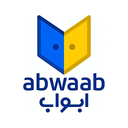
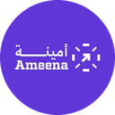
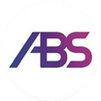
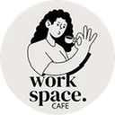
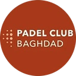

# Yousif Abdulkareem Al-Sara

**IT Engineer · Network & Infrastructure · AI & Automation** · Baghdad, Iraq

I design, build and run business IT (networks, firewalls, CCTV and access control, cloud and email), and I build AI-driven systems and automation that replace manual work.

Open to IT infrastructure, network, systems and automation roles, on-site in Iraq or remote.

**Portfolio:** [yousif4business-collab.github.io](https://yousif4business-collab.github.io)

---

### Experience

**IT Engineer** · Sama Babil Pharmaceutical Industry (Sumer Holding Group) · Apr 2026 – Oct 2026
- Ran the IT estate of an eight-floor headquarters and the group's manufacturing sites in Babil: core routing, switching, wireless, FortiGate firewalls, CCTV, access control and IP telephony.
- Migrated the group's corporate email to Google Workspace: phased mailbox migration, MX cutover and 2FA enforcement.
- Connected the Baghdad headquarters to the Babil factory sites, and led the move from metered bandwidth to a cheaper, higher-capacity fiber line.
- Built internal systems for asset inventory and fault logging, and automated the monthly reporting to Finance and management.

**IT Infrastructure & Support Specialist** · Abwaab & Ameena · 2025 – 2026
- Sole IT specialist for 300+ employees across a corporate headquarters, satellite offices and a warehouse.
- Built the headquarters from an empty building: structured cabling, per-floor racks, switching and Wi-Fi on every floor, building-wide IP CCTV, fingerprint access control, network printing and 300+ PCs.
- Designed the distribution of 20 fiber business internet lines across the whole estate.
- Built the warehouse and office networks from scratch, planned office moves so everything was live before staff arrived, created the companies' first IT documentation and asset records, and ran daily Level 1 / Level 2 support.

**Internships** · 2024
- Level 1 SOC Analyst, Firewall Cybersecurity Services: live SOC monitoring and incident analysis with Wazuh SIEM on AWS.
- Networking & Telecom Intern, Nokia: IP networking, optical communication and telecom infrastructure.

### Client projects

Clients served through [Rawafid](https://rawafid.space), an IT services company in Iraq:

<table>
<tr><td align="center" width="120"> Uber</td><td align="center" width="120"> Careem</td><td align="center" width="120"> Geely</td><td align="center" width="120"> Abwaab</td><td align="center" width="120"> Ameena</td><td align="center" width="120"> Al Majal Business Park</td></tr>
<tr><td align="center" width="120"> JP Law Group</td><td align="center" width="120"> Plastic &amp; Derma Clinic</td><td align="center" width="120"> ABS</td><td align="center" width="120"> Workspace</td><td align="center" width="120"> English Gate</td><td align="center" width="120"> Padel Club Baghdad</td></tr>
</table>

IT infrastructure delivered:

| Client | What was done |
|---|---|
|   **Abwaab + Ameena HQ** | Full IT fitout of a four-floor headquarters with 300+ devices: network, CCTV, access control, VoIP and electrical |
|  **Al Majal Business Park** | Commercial building fitout: network, CCTV, structured cabling and access control; internet delivery inside the eight-floor multi-tenant building |
|  **Geely (Al Majal office)** | Network and Wi-Fi for the Geely office at Al Majal Business Park, on the building network |
|  **Uber (Iraq office)** | Office network: switches, cabling and Wi-Fi |
|  **Careem Iraq** | Office network infrastructure and CCTV system installation |
|  **Ameena Warehouse** | Structured cabling and CCTV across the full warehouse |
|  **Abwaab Old Office** | Complete office network: switches, access points, patch panels and structured cabling |
|  **Abwaab Café office** | Temporary office during the move: CCTV plus full network and Wi-Fi |
|  **Ameena Old Office** | Structured cabling, full network setup and patch organisation |
|  **JP Law Group** | Secure, structured network for a law firm |
|  **Workspace serviced offices, Baghdad** | Managed network and Wi-Fi across 15 rented workspace offices |

### AI & automation

- **Internal business systems:** asset inventory, fault logging and automated monthly reports for management.
- **Messaging-bot automation:** a Telegram bot for an education platform that posts class messages, runs attendance roll-call, alerts families about absences and escalates to supervisors.
- **Scheduled back-office automation:** nightly subscription-expiry scans, daily delivery lists and a morning digest to the staff group for a meal-subscription business.
- **AI assistants:** a rate-limited AI assistant that answers visitor questions on a venue website (Cloudflare Workers AI).
- **Lead-generation automation:** finds organisations with published business contacts, prepares personalised outreach emails and tracks every lead in a shared sheet.

### Business development

- **IT services for corporate clients:** site surveys, proposals and quotations, vendor sourcing, handover documentation and maintenance contracts for the client projects above.
- **English Gate Academy:** led marketing and growth — monthly content plans across social channels, a workshop programme, B2B outreach to companies for staff English training, event and venue partnerships, and the academy's Google Business Profile and LinkedIn page.

### What I work with

| Area | Technologies |
|---|---|
| Networking | Routing and switching, VLANs, Wi-Fi, structured cabling, fiber, RADIUS / 802.1X |
| Network and security vendors | MikroTik, Cisco, Ubiquiti UniFi, TP-Link, Huawei, Fortinet FortiGate |
| Security | Firewall policy and segmentation, SOC operations, Wazuh SIEM, MFA / 2FA |
| CCTV and access control | Hikvision, Dahua, ZKTeco, fingerprint and face-recognition attendance |
| Systems and cloud | Windows, Active Directory, Microsoft 365, Google Workspace, AWS, Azure, Google Cloud |
| Servers and storage | Synology NAS, Linux (Ubuntu), Docker |
| Voice | IP-PBX telephony, SIP extensions, IP phones |
| AI and automation | Messaging bots, scheduled workflows, AI assistants, Supabase Edge Functions, Cloudflare Workers AI |
| Web development | TypeScript, React, Next.js, Vite, Tailwind CSS, Supabase, Prisma |

### Featured projects

| Project | What it does | Stack |
|---|---|---|
| [lowcarb-site](https://github.com/yousif4business-collab/lowcarb-site) · [live](https://lowcarb-site.pages.dev) | Meal-subscription platform for a Baghdad kitchen: public marketing site, plus a customer app and a staff order-management system on the same backend, with Row-Level Security, scheduled automation and a CI pipeline gated by 92 end-to-end tests | React, Vite, Supabase, Cloudflare Pages, GitHub Actions, Playwright |
| [workspace-cafe](https://github.com/yousif4business-collab/workspace-cafe) · [live](https://workspace-cafe.pages.dev) | Bilingual (Arabic/English) site for a Baghdad café, rooftop padel club and business suites: menu and cart, court and meeting-room booking, padel shop with WhatsApp ordering, rate-limited AI assistant | React 19, TypeScript, Vite, Cloudflare Pages, Workers AI |
| [smart-cnc-plotter](https://github.com/yousif4business-collab/smart-cnc-plotter) | Graduation project: low-cost 3-axis CNC that engraves and carves wood, plastic and cardboard, built for under 240,000 IQD with Arduino electronics and 3D-printed parts | Arduino UNO, CNC Shield V3, A4988, NEMA 17, CamBam, UGS |
| [aklaat-albaraka](https://github.com/yousif4business-collab/aklaat-albaraka) | One-file ordering site for a home-style Iraqi kitchen: menu, cart with delivery fees by area, WhatsApp ordering with order numbers and GPS location sharing | HTML, CSS, JavaScript |

### Live client work

- **[English Gate Academy](https://englishgate-school.com)** — bilingual (Arabic/English) website for an English academy in Baghdad, part of a wider platform with a staff system (CENTER) and a phone-first app for families, students and teachers (APP) on Supabase with Row-Level Security
- **[Rawafid](https://rawafid.space)** — website for an IT services company in Iraq: network infrastructure, CCTV, AI and automation, and software
- **[Lavender](https://lavender-dbd.netlify.app)** — Arabic store for natural hair and skin-care products, ordering through WhatsApp

### Private projects (code available on request)

- **Padel court booking platform** — Arabic booking wizard, admin dashboard, ZainCash and FIB payment webhooks (Next.js, Prisma, MongoDB)

### Education

- **B.Sc. Computer Engineering**, Al-Nahrain University, 2025 — graduation project: [Smart CNC Plotter](https://github.com/yousif4business-collab/smart-cnc-plotter) (Arduino)
- **Certification:** Java Programming (2022)
- **Languages:** Arabic (native), English (professional working proficiency)

### Contact

[yousifabdulkareem4business@gmail.com](mailto:yousifabdulkareem4business@gmail.com) · [LinkedIn](https://www.linkedin.com/in/yousif-abdulkareem-al-sara-4220b1189) · [Portfolio](https://yousif4business-collab.github.io)
